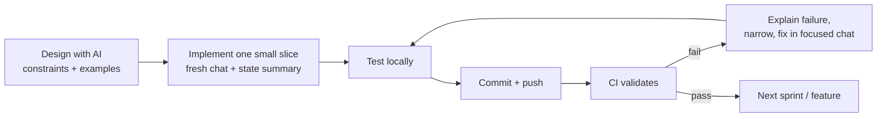

# AI-Assisted Development of TrustVault

This document explains **how AI was used to build TrustVault, why each practice
was chosen, and why it makes AI assistance more reliable**. It complements the
chronological log in [`PROMPTS.md`](../PROMPTS.md). The *Prompt/Action* and
*Reason* entries are the project owner's account of their process; the *Why this
works for AI* and *Evidence* lines were added from analysis of the repository.
Evidence that could not be verified from the repo is marked **Needs confirmation**.

## Table of contents

1. [Summary](#1-summary)
2. [Setup phase](#2-setup-phase)
3. [Development phase](#3-development-phase)
4. [Deployment phase](#4-deployment-phase)
5. [Updates and new features](#5-updates-and-new-features)
6. [Overall philosophy](#6-overall-philosophy)
7. [Where AI output needed correction](#7-where-ai-output-needed-correction)
8. [Reusable prompt templates](#8-reusable-prompt-templates)
9. [Limits of this record](#9-limits-of-this-record)

---

## 1. Summary

AI was used as a **development assistant**, not as an author whose output is
accepted as final. Every stage followed the same loop:



Why this matters for a security product: language models produce plausible
code whether or not it is correct. The practices below add **constraints,
context, and independent verification** so that plausibility is checked against
evidence.

| Principle | What it guards against |
|---|---|
| State constraints up front | Convenient-but-insecure defaults |
| Give concrete examples | Ambiguous requirements |
| Small, isolated tasks | Context drift and unrelated edits |
| Test, then commit | Unverified code entering history |
| Independent CI | "Works on my machine" |
| Narrow bugs by evidence | Guess-driven, speculative fixes |

---

## 2. Setup phase

### 2.1 Choosing the technology stack

- **Prompt/Action:** Asked AI to recommend the best stack with a strong focus on
  security, without compromising the application's security requirements.
- **Reason:** Major architectural decisions had to be settled before code. Since
  TrustVault handles confidential documents, technologies could not be picked
  just for ease of development; the stack needed secure authentication,
  authorization, private file storage, audit logging, and safe document handling.
- **Why this works for AI:** A model optimises for the goal in the prompt. If
  the goal is "build quickly", it picks popular defaults; naming security as a
  non-negotiable constraint changes the ranking of options and makes trade-offs
  explicit. It also gives the model a rubric to justify every choice against.
- **Evidence:** ASP.NET Core Identity + JWT with a deny-by-default fallback
  policy (`Program.cs`), PostgreSQL with separated roles
  (`database/setup-roles.sql`), isolated converter container
  (`docker-compose.yml`), ClamAV scanning (`ClamAvPrivateDocumentScanner.cs`).

### 2.2 Understanding the full workflow first

- **Prompt/Action:** Asked AI how the application should be built and for the
  complete workflow of the system.
- **Reason:** To see how authentication, upload, sharing, access, auditing and
  revocation connect, instead of building isolated features.
- **Why this works for AI:** Models handle a task far better when they hold the
  whole system model in context. A workflow-first prompt exposes cross-cutting
  rules (e.g. "revocation must take effect immediately") before any code is
  written, so later prompts can reference them instead of re-inventing them.
- **Evidence:** Grants are checked on every request and unauthorised users get
  404 (`DocumentsController.cs`, `docs/api.md`); every request revalidates the
  account's security stamp (`Program.cs` `OnTokenValidated`).

### 2.3 Designing the solution before generating code

- **Prompt/Action:** Designed the solution for the problem statement with
  Claude as a design partner.
- **Reason:** To explore architecture, security considerations, workflows and
  alternatives before implementation, so decisions came from the project's
  requirements rather than from whatever code the model produced first.
- **Why this works for AI:** Design conversations are cheap to change and
  expose assumptions; code is expensive. It also turns the model into a
  reviewer of ideas, which suits it better than being a one-shot generator, and
  leaves a written design that later prompts can quote.
- **Evidence:** `docs/architecture.md` (now `ARCHITECTURE.md`), `THREATS.md`,
  and `docs/backlog.md` pre-date or accompany the code, and the backlog
  contains sprint plans and explicit "not implemented" items.

### 2.4 Using examples in prompts

- **Prompt/Action:** Included concrete examples when asking AI to design or
  implement a feature.
- **Reason:** Examples show how a real user would use the feature and what
  should happen in different situations, reducing ambiguity.
- **Why this works for AI:** Language models are strong pattern-completers.
  An example fixes the expected input, output, and edge case, which turns a
  vague requirement into something testable. Scenario-style examples ("a
  revoked user opens the old document ID and gets 404") convert almost
  directly into test cases.
- **Evidence:** The README walkthrough and tests mirror scenarios: the
  revoked-grant-returns-404 case and the "different account cannot retrieve
  another owner's document, even with its ID" case (`ApiAuthorizationTests.cs`;
  noted in the project's earlier README).

---

## 3. Development phase

### 3.1 Agile sprints

- **Prompt/Action:** Split the project into six sprints after Sprint 0, seven
  in total.
- **Reason:** Building everything at once makes it hard to find where a defect
  was introduced; small sprints can be developed, tested, reviewed and
  stabilised before moving on.
- **Why this works for AI:** Smaller scope means smaller outputs, which are
  easier to review and less likely to contain hidden inconsistencies. Each
  sprint gives the model a precise definition of done, so it is less likely to
  add speculative features.
- **Evidence:** `docs/backlog.md` has Sprint 0, 1, 2, 3, 4, 5 and 6 sections;
  `PROMPTS.md` entries stop at defined slices ("stop before Sprint 1").

### 3.2 A new chat per sprint or major feature, opened with a state summary

- **Prompt/Action:** Started a fresh chat for each sprint/feature, first
  summarising what existed and then describing the next task.
- **Reason:** To keep tasks focused and avoid carrying unnecessary history,
  while still giving the AI the current project state.
- **Why this works for AI:** Long conversations dilute attention and accumulate
  contradictory or outdated statements. A fresh chat with a curated summary
  keeps the context **short, current and relevant**, and means the model works
  from the project's actual state rather than from earlier, since-changed
  decisions.
- **Evidence:** `PROMPTS.md` entries each declare what was asked, produced and
  corrected; the project docs (`README`, `docs/api.md`) are maintained as the
  single source of current state.

### 3.3 Save, commit and push every sprint and sub-sprint

- **Prompt/Action:** For each (sub-)sprint, saved working changes, committed,
  pushed to GitHub and checked the CI workflows.
- **Reason:** Every stable stage should be recoverable so a later problem can be
  traced and reverted rather than losing working code.
- **Why this works for AI:** AI edits can silently break unrelated behaviour.
  Frequent, small commits make each model-generated change a reviewable diff
  and a revert point, which turns an unpredictable generator into a controlled
  contributor.
- **Evidence:** `PROMPTS.md` records commit references (e.g. `23bcfcd…` for
  Sprint 0) and CI runs (`5db247e`); several entries note "uncommitted" until
  the commit exists. Full git history **Needs confirmation** (not in the zip).

### 3.4 Test before committing

- **Prompt/Action:** Ran tests before committing each sprint and feature.
- **Reason:** Commits should represent working versions; local tests catch
  functional and regression problems before they reach the repository and CI.
- **Why this works for AI:** Tests are **independent ground truth**. The model
  cannot be trusted to grade its own work, but a failing test is objective.
  Test output also gives the model concrete error text for the next prompt.
- **Evidence:** `backend/TrustVault.Tests/` (xUnit) and frontend specs; the log
  reports concrete test runs per sprint, and failures that revealed real
  defects (see [section 7](#7-where-ai-output-needed-correction)).

### 3.5 Narrow bugs by separating what works from what doesn't

- **Prompt/Action:** When something broke, asked the AI to identify what was
  working and what was not, rather than saying "it's not working".
- **Reason:** A broad statement doesn't identify the failure; separating
  working from failing parts shrinks the set of possible causes.
- **Why this works for AI:** Diagnosis is a search problem. "It doesn't work"
  leaves the model to guess; a partitioned description (working path, failing
  path, exact error) lets it form and test a specific hypothesis. This
  sharply reduces confident-sounding but wrong fixes.
- **Evidence:** The "Fixing grant-list failure" entry in `PROMPTS.md`: the
  owner could grant but not list or revoke; this narrowed the cause to an EF
  Core query ordering on a constructed DTO, producing an HTTP 500, fixed by
  ordering the projection first and adding regression assertions.

### 3.6 Separate chats for major bugs

- **Prompt/Action:** Used a new chat for large bugs, then tested and committed
  the fix as a sub-sprint.
- **Reason:** Large debugging threads get tangled with feature work; separate
  chats keep the investigation traceable and produce a clear change history.
- **Why this works for AI:** Isolating the bug removes unrelated code and
  requirements from context, so the model reasons about one failure. The
  resulting commit has a single purpose, which makes the fix easy to review
  and to revert.
- **Evidence:** Bug entries in `PROMPTS.md` have their own headings and causes
  (grant-list failure; test-host rate-limit exhaustion). Which fixes were done
  in separate chats **Needs confirmation**.

---

## 4. Deployment phase

### 4.1 Researching the deployment provider

- **Prompt/Action:** Used Perplexity to research providers matching the app's
  backend, database, private-storage, CI/CD and resource needs. Render and
  Railway were considered suitable; the app was deployed on **Railway**.
- **Reason:** The provider should not be chosen only because it is popular or
  easy; requirements around execution, database, storage, CI/CD and resource
  usage drove the choice.
- **Why this works for AI:** A research tool with live sources is better than a
  model's memory for fast-changing facts such as plans, limits and prices.
  Giving it explicit requirements yields a comparison against *your* needs
  rather than generic advice.
- **Evidence:** `PROMPTS.md` records provider changes (Render → AWS →
  Railway, the last not documented in the repo). The repo has no Railway
  configuration (**Needs confirmation**).

### 4.2 Connecting deployment with CI/CD

- **Prompt/Action:** Configured the flow so a push triggers CI and, after
  validation, a redeploy.
- **Reason:** Avoid manual deployments and human error; make the deployed
  version follow the same validation as the repository.
- **Why this works for AI:** It removes a step where AI-generated changes could
  be hand-deployed without checks, keeping the verification loop closed.
- **Evidence:** `ci.yml` runs backend, frontend and container jobs on every
  push. It contains no deploy step; the redeploy trigger is configured on
  Railway (**Needs confirmation**).

### 4.3 Keeping the 2 GB document-scanning requirement

- **Prompt/Action:** Configured production for the ~2 GB memory the scanning
  engine needs instead of disabling it to fit a smaller plan.
- **Reason:** Malware scanning is resource-intensive; keeping security
  mechanisms on was prioritised over fitting a smaller configuration.
- **Why this works for AI:** Stating "do not weaken the security control" gives
  the model a hard constraint; without it, assistants often suggest the quick
  fix of disabling or bypassing the failing component.
- **Evidence:** `docker-compose.yml` sets ClamAV `mem_limit: 2g`;
  `SystemController.Ready` fails closed when ClamAV is down; no setting exists
  to bypass scanning.

### 4.4 Free-tier limitation (current known limitation)

- **Prompt/Action:** The 2 GB configuration is unavailable on free options
  accessible to the owner; paid-tier activation was blocked because
  international transactions were not enabled on the owner's debit card.
- **Reason:** Staying within budget was important, but the security design was
  not compromised to fit a free tier.
- **Status:** A minor, infrastructure-only limitation rather than a code
  defect. Observed on Railway: `clamav` restarts in a loop and `clamd` never
  starts, so `/api/system/ready` returns 503 and the `TrustVault` deploy is
  marked unhealthy. Probable cause: insufficient RAM (and a 500 MB volume);
  the actual `clamd` error was not in the logs (**Needs confirmation**).
- **Simple fix:** Use a paid plan, raise `clamav` memory to ~2 GB, grow the
  volume, redeploy `clamav`, then `TrustVault` (see
  [SETUP.md](SETUP.md#8-deployment-on-railway)).
- **Why recording this helps AI-assisted work:** Writing the limitation and its
  cause down gives future prompts accurate context and stops an assistant from
  "fixing" it by weakening scanning.

---

## 5. Updates and new features

### 5.1 New chat for every feature

- **Prompt/Action:** Started a new chat per feature, explaining the current
  project summary, existing functionality and the exact feature.
- **Reason:** Treat each feature as an independent task with enough context and
  lower risk of touching unrelated code.
- **Why this works for AI:** A precise, bounded request ("add X; do not change
  Y") limits scope creep and unrelated edits.
- **Evidence:** Incremental features in `PROMPTS.md`: named-user sharing,
  Administrator-managed members, Administrator oversight console, each with
  scoped tests.

### 5.2 Test locally before pushing

- **Prompt/Action:** Confirmed each feature locally before commit and push.
- **Reason:** Catch obvious problems before the shared repository and CI; a CI
  failure is then more likely an integration or environment issue.
- **Why this works for AI:** It reduces the search space: if local tests pass
  and CI fails, the model can be pointed at environment differences.
- **Evidence:** `PROMPTS.md` validation notes (format, build, tests, lint, EF
  consistency) per entry.

### 5.3 Run CI after every push

- **Prompt/Action:** Monitored CI after each push.
- **Reason:** Local tests cannot prove the app builds and passes in a clean
  environment; CI adds validation for build, dependency, test, config and
  pipeline issues.
- **Why this works for AI:** A clean-room run catches AI-introduced hidden
  dependencies on local state, which is a typical failure of generated code.
- **Evidence:** `ci.yml`: format check, Release build, DB role provisioning,
  migrations, tests, EF pending-model-changes check, frontend lint/test/build/
  audit, Docker image build.

### 5.4 Use the GitHub agent to explain CI failures

- **Prompt/Action:** When CI failed, used the GitHub Agent to explain the failed
  job and its cause.
- **Reason:** Understand which stage failed and why before changing code on
  assumption.
- **Why this works for AI:** Real logs are the best possible prompt input. An
  explanation grounded in actual failure output prevents speculative edits.
- **Evidence:** `.github/copilot-instructions.md` exists; the specific CI
  failures explained are **Needs confirmation** (GitHub Actions history is not
  in the zip).

### 5.5 Re-test after fixing CI failures

- **Prompt/Action:** After a fix, re-tested, committed and pushed so CI could
  validate it again.
- **Reason:** A fix is not complete merely because the first error vanished; it
  must pass without causing a new failure elsewhere.
- **Why this works for AI:** Fixes by a model often resolve the cited symptom
  while introducing regressions; re-running the full suite verifies the whole
  change.
- **Evidence:** Regression assertions added with fixes (grant list), and the
  full-suite reruns recorded in `PROMPTS.md`.

---

## 6. Overall philosophy

- **Prompt/Action:** AI was used for architecture exploration, implementation
  guidance, debugging, testing and troubleshooting, not as a single
  authoritative output.
- **Reason:** The project is security-sensitive, so control stayed with the
  developer, using iteration, tests, Git, CI and debugging to verify results.
- **Why this works for AI:** Treating output as a hypothesis to be verified
  matches how language models actually behave: strong at drafting and
  explaining, unreliable at guaranteeing correctness. The human supplies
  constraints, context, and verification; the AI supplies speed and options.
- **Evidence:** `THREATS.md` and README-style statements avoid overclaiming
  (e.g. the audit chain is "not tamper-proof"; the storage provider is
  "development only").

---

## 7. Where AI output needed correction

These real corrections from `PROMPTS.md` show why verification is part of the
method.

| Date | AI output problem | Correction |
|---|---|---|
| 2026-11-02 | Generated API template targeted the wrong .NET version and exposed a weather-forecast sample route | Retargeted to the required stack, removed the sample route, added tests for anonymous denial |
| 2026-11-02 | Scaffolded Angular 18 packages had known production vulnerabilities | Upgraded to patched Angular 21.2.x; `npm audit --omit=dev` is now part of CI |
| 2026-11-02 | Anonymous readiness endpoint conflicted with "health is the only anonymous route" | Made readiness authenticated at the time; it is anonymous in the current code (`SystemController.cs`), a later change **Needs confirmation** |
| 2026-11-03 | EF Core query ordered on a DTO property, causing HTTP 500 for grants | Order the projection first; regression assertions |
| 2026-11-03/04 | Test host exhausted the production-sized auth rate limit | Made the limit configurable and raised it only in the test host |
| 2026-11-05 | Early test run used default local DB credentials instead of an isolated database | Re-ran against `trustvault_admin_tests` |
| 2026-11-02 | Docs overstated tooling and budget status | Rewrote to record only verified facts |

## 8. Reusable prompt templates

Derived from the practices above.

**New-feature chat**

```text
Context: TrustVault, ASP.NET Core 10 + Angular 21 + PostgreSQL. Current state:
<paste summary: what exists, what is deliberately NOT implemented>.
Task: implement <one feature> only.
Constraints: deny by default; server-side authorization; no secrets in code;
do not weaken malware scanning or audit logging; do not change <unrelated areas>.
Example: when <actor> does <action>, the result must be <outcome>; when <edge
case>, return <status>.
Done means: tests for the example and the edge case pass, format check passes.
```

**Bug chat**

```text
Working: <what works, with how I verified>.
Failing: <exact steps, exact error text/log, expected vs actual>.
Not yet checked: <list>.
Give me hypotheses ranked by likelihood and the one check that separates them,
before proposing any code change.
```

**CI failure**

```text
Here is the failing job log: <paste>. Explain which step failed and why.
Do not change code yet; tell me what evidence would confirm the cause.
```

## 9. Limits of this record

- The git history, GitHub Actions history and Railway project were not
  available; commit and CI claims come from `PROMPTS.md`.
- `PROMPTS.md` records Render → AWS → Railway provider changes; only Railway is
  the current deployment, per the owner.
- *Why this works* statements are explanatory rationale, not measured results;
  no experiment comparing prompting styles was performed in this repository.
