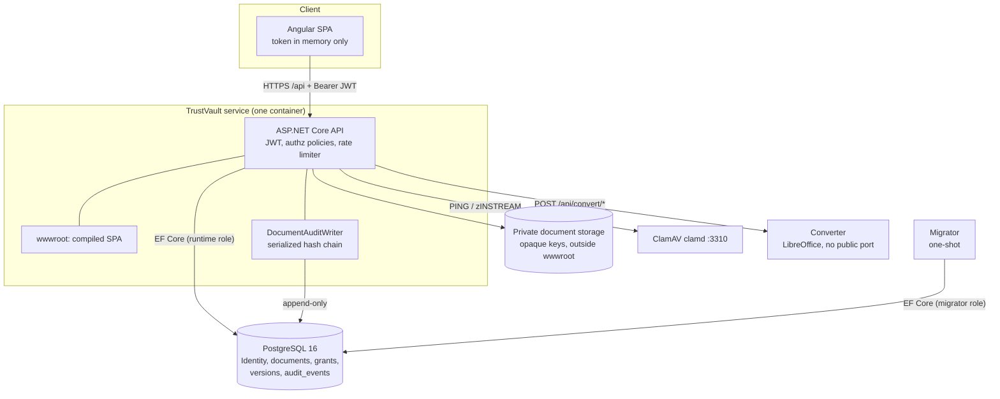
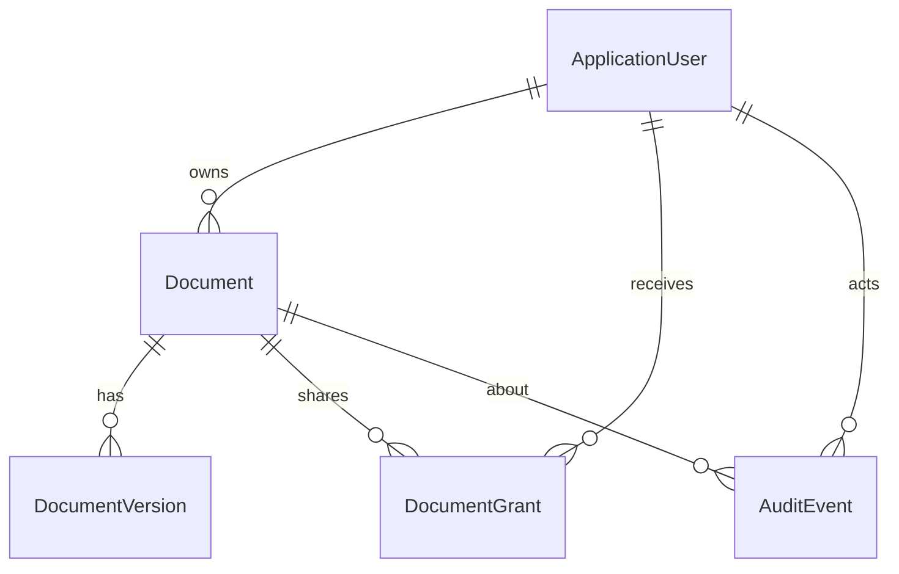
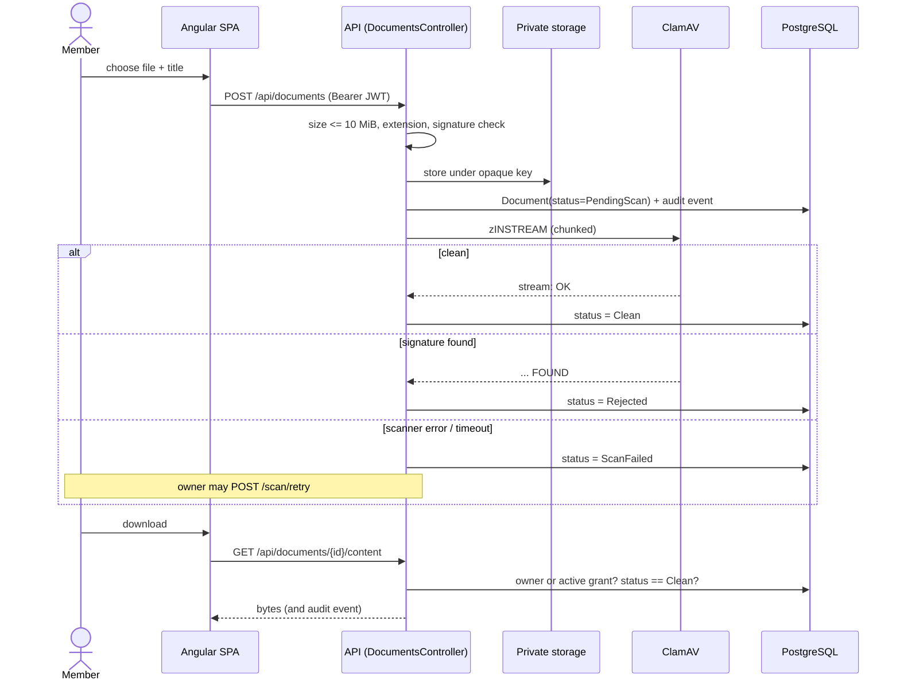
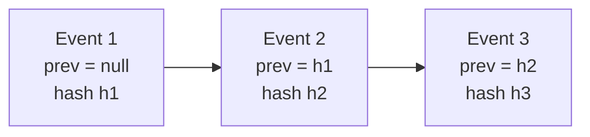
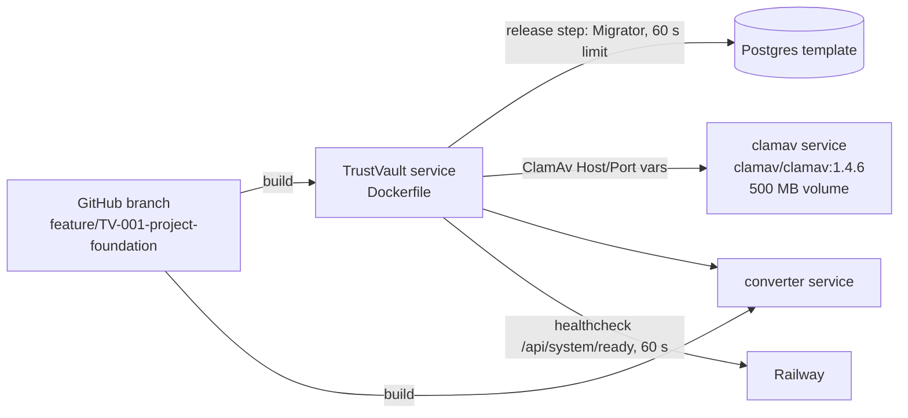

# TrustVault Architecture

This document **replaces** the earlier `docs/architecture.md` ("Sprint 0
architecture"). Every claim cites the file it came from; unverified items are
marked **Needs confirmation**.

## Table of contents

1. [Overview](#1-overview)
2. [Layers and projects](#2-layers-and-projects)
3. [System diagram](#3-system-diagram)
4. [Trust boundaries](#4-trust-boundaries)
5. [Authentication and authorization](#5-authentication-and-authorization)
6. [Data model](#6-data-model)
7. [Upload, scan, and download flow](#7-upload-scan-and-download-flow)
8. [Audit hash chain](#8-audit-hash-chain)
9. [Document conversion service](#9-document-conversion-service)
10. [Database role separation](#10-database-role-separation)
11. [Readiness and health](#11-readiness-and-health)
12. [Runtime topology](#12-runtime-topology)
13. [Known limitations and unverified areas](#13-known-limitations-and-unverified-areas)

---

## 1. Overview

TrustVault is a single deployable web application: an ASP.NET Core 10 API that
also serves the compiled Angular SPA from `wwwroot` (`Dockerfile` copies
`dist/trustvault-web/browser/` into `./wwwroot/`; `Program.cs` calls
`UseDefaultFiles`, `UseStaticFiles`, `MapFallbackToFile("index.html")`).
Supporting services are PostgreSQL, ClamAV, and an isolated LibreOffice
converter. `/api/{**path}` unknown routes return 404 rather than the SPA.

## 2. Layers and projects

| Project | Responsibility | Key files |
|---|---|---|
| `TrustVault.Domain` | Entities and rules with no infrastructure dependency | `Documents/Document.cs`, `DocumentGrant.cs`, `DocumentVersion.cs`, `DocumentScanStatus.cs`, `DocumentPermission.cs`, `Audit/AuditEvent.cs`, `AuditEventHash.cs`, `AuditChainVerifier.cs`, `Security/UserRoles.cs` |
| `TrustVault.Application` | Ports (interfaces) | `IPrivateDocumentStorage.cs`, `IPrivateDocumentScanner.cs` |
| `TrustVault.Infrastructure` | Adapters | `ApplicationDbContext.cs`, `Migrations/`, `ClamAvPrivateDocumentScanner.cs`, `FileSystemPrivateDocumentStorage.cs`, `DatabaseConnectionStrings.cs` |
| `TrustVault.Api` | HTTP surface, auth, rate limiting, composition root | `Program.cs`, `Controllers/*`, `Services/*` |
| `TrustVault.Migrator` | Run EF migrations; verify audit chain | `Program.cs` (`--verify-audit`) |
| `TrustVault.Converter` | Separate service wrapping LibreOffice | `Program.cs`, `LibreOfficeConverter.cs` |
| `frontend/` | Angular 21 SPA | `src/app/*`; token held in memory (`auth-session.store.ts`) |

Dependencies (from `.csproj`): Api → Application + Infrastructure;
Infrastructure → Application + Domain; Application → Domain.

## 3. System diagram

## 4. Trust boundaries

| Boundary | Control | Evidence |
|---|---|---|
| Browser → API | JWT validated for signature, issuer, audience, lifetime (30 s skew); CORS restricted to `Frontend:Origin` | `Program.cs` |
| Per-request revocation | Each authenticated request loads the user and rejects suspended accounts or a changed security stamp | `OnTokenValidated` in `Program.cs` |
| Forced password change | Accounts with `MustChangePassword` may call only `POST /api/auth/change-password` | `Program.cs` |
| API → ClamAV | Non-Development hosts may not be `localhost`, loopback, or "any" address | `Program.cs` |
| API → Converter | Converter is not publicly published; locally reached via an Nginx relay bound to `127.0.0.1:6100` | `docker-compose.yml`, `nginx.conf` |
| App → DB | Separate `trustvault_runtime` (CRUD) and `trustvault_migrator` (owner) roles; runtime has only SELECT/INSERT on `audit_events` | `database/setup-roles.sql` |
| Uploads | 10 MiB cap, extension allow-list, signature/structure checks, opaque storage key | `DocumentsController.cs`, `FileSystemPrivateDocumentStorage.cs` |

## 5. Authentication and authorization

- **Fallback policy:** `RequireAuthenticatedUser()`; anonymous access is explicit
  (`[AllowAnonymous]`), e.g. `system/health`, `system/ready`, and the SPA
  fallbacks (`Program.cs`, `SystemController.cs`).
- **Roles:** `Administrator`, `Viewer` (`UserRoles.cs`). `AdminPolicy` requires
  the Administrator role; admin controllers use
  `[Authorize(Roles = UserRoles.Administrator)]`.
- **Document access:** owner or active named grant. Unauthorised users get
  **404** instead of 403 (`DocumentsController.cs`, `docs/api.md`).
- **Administrator and content:** administrators see metadata only; they need a
  grant like anyone else to read content (`AdminOversightController.cs`; `docs/api.md` states the documents endpoint
  never returns bytes, storage keys, or download URLs).
- **Passwords:** minimum length 12, digit, upper, lower, non-alphanumeric;
  lockout after 5 failures for 15 minutes (`Program.cs`).
- **Tokens:** access token 5–30 min (default 15) via `Jwt:AccessTokenLifetimeMinutes`;
  refresh tokens are issued, rotated, revoked server-side
  (`AuthenticationService.cs`, migration `AddRefreshTokenFields`). The refresh
  lifetime comes from `Jwt:RefreshTokenLifetimeDays`; its default value is
  **Needs confirmation**.
- **Rate limiting:** fixed window, 1 minute, per `IP:path`, default 10
  permits (`RateLimits:AuthenticationPermitLimit`); in-memory, so per-instance
  (`Program.cs`).

## 6. Data model

Entities exposed by `ApplicationDbContext`: `Documents`, `DocumentGrants`,
`DocumentVersions`, `AuditEvents`, plus ASP.NET Identity tables
(`ApplicationUser`).

Relationship cardinalities are drawn from entity names and the API; exact
columns, keys, and indexes are in
`TrustVault.Infrastructure/Persistence/Migrations/ApplicationDbContextModelSnapshot.cs`
(**Needs confirmation** for any column-level detail not listed here).

Migrations (chronological): `InitialCreate` (2026-11-02),
`AddRefreshTokenFields` (11-04), `AddDocumentScanStates` (11-04),
`AddAdministratorManagedMembers` (11-04).

Enums: `DocumentScanStatus` = PendingScan, Scanning, Clean, Rejected,
ScanFailed; `DocumentPermission` = Read, Edit.

## 7. Upload, scan, and download flow

The scanner retries once on I/O failure or timeout
(`ClamAvPrivateDocumentScanner.cs`, `MaximumAttempts`); verdict parsing is
covered by `ClamAvPrivateDocumentScannerTests.cs` (`stream: OK` → Clean,
`... FOUND` → Rejected). The **exact placement of status transitions** inside
`DocumentsController` upload (synchronous vs. deferred) follows the earlier project README
("uploads are synchronously scanned"); confirm in `DocumentsController.cs`
before relying on it (**Needs confirmation**).

## 8. Audit hash chain

- Each `AuditEvent` stores `PreviousHash` and a hash computed by
  `AuditEventHash.Calculate`: SHA-256 (lower-case hex) over a JSON record of
  `Id, ActorUserId, ActorRole, DocumentId, Action, Result, TimestampUtc,
  RequestId, IpAddress, UserAgent, MetadataJson (canonicalised, keys sorted
  ordinally), PreviousHash`.
- `CalculateLegacy` keeps older events verifiable.
- Writes are serialized by `DocumentAuditWriter`; `AuditEventImmutabilityTests`
  and a database trigger (`prevent_audit_event_mutation`, referenced in
  `setup-roles.sql`) block updates and deletes.
- Verification: `dotnet run --project backend\TrustVault.Migrator -- --verify-audit`
  or `GET /api/admin/audit/verify` (`Migrator/Program.cs`).
- **Limit:** detects altered records and broken links; cannot detect tail
  deletion or a complete rewrite without external anchoring (`THREATS.md`, `docs/backlog.md`).

## 9. Document conversion service

`TrustVault.Converter` exposes `GET /health`, `POST /api/convert/to-text`
(`?extension=.doc|.docx`), and `POST /api/convert/to-docx`
(`Converter/Program.cs`). It caps bodies at 10 MiB and extracted text at
2,000,000 characters, returns 503 if LibreOffice is unavailable and 422 if a
file cannot be converted. Its container image installs `libreoffice-writer`
(`Converter/Dockerfile`). Locally it runs read-only, `cap_drop: ALL`,
768 MB memory, 1 CPU (`docker-compose.yml`). The API reaches it through
`DocumentConversion:Endpoint` (default `http://localhost:6100/`,
`DocumentTextConverter.cs`) with a 45 s client timeout (`Program.cs`).

## 10. Database role separation

`database/setup-roles.sql` creates two roles: `trustvault_migrator` (owns the
database and schema; used by the migrator) and `trustvault_runtime` (CRUD on
tables, sequences; **SELECT and INSERT only** on `audit_events`). The API
refuses to fall back to the migrator credential
(`DatabaseConnectionStrings.cs`: `Get` vs `GetMigrator`). The passwords in the
script are **local-only**; production provisioning of these roles on Railway is
**Needs confirmation**.

## 11. Readiness and health

| Endpoint | Behaviour | Source |
|---|---|---|
| `GET /api/system/health` | Always `{"status":"ok"}` while the process is up | `SystemController.Health` |
| `GET /api/system/ready` | `CanConnectAsync` to PostgreSQL **and** a ClamAV `PING` expecting `PONG`; otherwise 503 `not_ready` | `SystemController.Ready`, `ClamAvPrivateDocumentScanner.CheckReadinessAsync` |

Consequence: any platform healthcheck pointed at `/api/system/ready` reports
the app unhealthy when ClamAV is down. This is intentional fail-closed
behaviour; use `/api/system/health` for a liveness-only probe.

## 12. Runtime topology

Local (`docker-compose.yml`): `postgres` (host 55432), `clamav`
(`clamav/clamav:1.4.6`, `127.0.0.1:3310`, 2 GB, 1 CPU), `converter` (internal
network only), `converter-dev-proxy` (Nginx 1.29, `127.0.0.1:6100`).

Railway (from the owner's inspection; **Needs confirmation**, not in repo):

## 13. Known limitations and unverified areas

- **ClamAV on Railway (minor, infrastructure-only).** `clamd` does not start on
  the current resources, so readiness fails. Fix: raise the `clamav` memory
  (~2 GB), enlarge its volume, redeploy `clamav`, then `TrustVault`. No code
  change needed. Logs did not show the actual `clamd` error (**Needs
  confirmation**).
- Filesystem document storage is a development provider; durable storage on
  Railway **Needs confirmation**.
- Audit chain is not tamper-proof (no external anchor).
- No MFA, email verification, or self-service password recovery (`docs/backlog.md`).
- In-memory rate limiter does not coordinate across instances.
- Container listens on `PORT` if set (`Program.cs`), otherwise
  `ASPNETCORE_HTTP_PORTS=10000` from the `Dockerfile`; Railway's 8080 is
  presumably injected via `PORT` (**Needs confirmation**).
