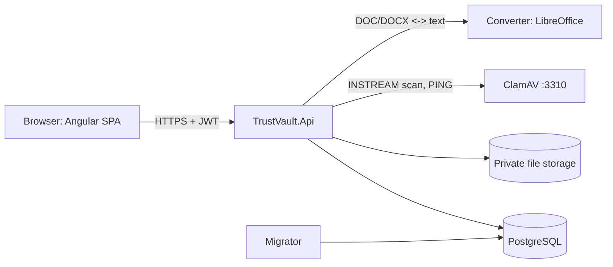

# TrustVault

> A security-focused, administrator-managed document-sharing platform: private
> PDF/TXT/DOC/DOCX storage, malware scanning, named-user READ/EDIT sharing,
> version history, and a hash-chained audit trail.

**Status:** prototype, not production-ready. Use dummy files only. Claims in
this documentation cite their source file; anything not verifiable from the
code is marked **Needs confirmation**.

## Table of contents

1. [Project purpose and intended users](#1-project-purpose-and-intended-users)
2. [Repository structure](#2-repository-structure)
3. [Quick start](#3-quick-start)
4. [Configuration](#4-configuration)
5. [Main features and workflows](#5-main-features-and-workflows)
6. [API overview](#6-api-overview)
7. [Testing and linting](#7-testing-and-linting)
8. [Deployment (Railway)](#8-deployment-railway)
9. [Architecture at a glance](#9-architecture-at-a-glance)
10. [Contributing](#10-contributing)
11. [Known limitations and gaps](#11-known-limitations-and-gaps)
12. [Documentation map](#12-documentation-map)

---

## 1. Project purpose and intended users

TrustVault lets an organisation share confidential documents with **named
accounts only**, with every access decision enforced server-side and recorded
in a tamper-evident audit chain.

| Role | What they can do | Evidence |
|---|---|---|
| **Administrator** (exactly one, bootstrapped from config) | Create/remove member accounts, reset credentials, view platform counts, search/export audit metadata, verify the audit chain, review alerts, revoke grants, reassign ownership. **Cannot read document content without a grant.** | `UserRoles.cs`, `AdminBootstrapper` (`AdministratorBootstrapper.cs`), `AdminMembersController.cs`, `AdminOversightController.cs` |
| **Member** (`Viewer` base role) | Upload documents (becoming owner), share with named users as READ or EDIT, revoke, edit, view history. | `UserRoles.Viewer`, `DocumentsController.cs` |
| **Grantee** | Access a shared document according to an active READ or EDIT grant. | `DocumentPermission.cs` (`Read`, `Edit`) |

There is **no public registration**; the Administrator creates every account
(`AuthController.cs` exposes only login/refresh/logout/change-password).

## 2. Repository structure

```text
TrustVault/
├── backend/
│   ├── TrustVault.Api/            ASP.NET Core 10 API: controllers, JWT auth, rate limiting, static SPA hosting
│   ├── TrustVault.Application/    Contracts: IPrivateDocumentStorage, IPrivateDocumentScanner
│   ├── TrustVault.Domain/         Document, DocumentGrant, DocumentVersion, AuditEvent, hash + chain verifier
│   ├── TrustVault.Infrastructure/ EF Core + Identity + PostgreSQL, ClamAV client, filesystem storage, migrations
│   ├── TrustVault.Migrator/       One-shot migration runner; also `--verify-audit`
│   ├── TrustVault.Converter/      Isolated LibreOffice service for DOC/DOCX <-> text
│   └── TrustVault.Tests/          xUnit integration/unit tests
├── frontend/                      Angular 21 SPA (pdf-lib for the in-browser PDF editor)
├── database/setup-roles.sql       Restricted migrator/runtime PostgreSQL roles (local credentials only)
├── docs/                          Architecture, setup, testing, AI-development notes (+ legacy api/backlog/deployment)
├── .github/workflows/ci.yml       Backend, frontend, container CI jobs
├── docker-compose.yml             Local PostgreSQL, ClamAV, converter, converter dev proxy
├── Dockerfile                     Multi-stage image: Angular build + API + migrator
├── THREATS.md, PROMPTS.md         Threat notes; AI prompt log
└── TrustVault.sln
```

Dependency direction (from the `.csproj` `ProjectReference` entries):
`Api → Application, Infrastructure`; `Infrastructure → Application, Domain`;
`Application → Domain`; `Migrator → Infrastructure`.

## 3. Quick start

Prerequisites: .NET 10 SDK, Node.js 20.19+ or 22.12+, Docker Desktop with
Compose. Full, step-by-step instructions are in **[docs/SETUP.md](docs/SETUP.md)**.

```powershell
docker compose up -d --build --force-recreate postgres clamav converter converter-dev-proxy
# ...apply role script, set env vars, run migrator, then:
dotnet run --project backend\TrustVault.Api      # http://localhost:5106
cd frontend; npm ci; npm start                   # http://localhost:4200
```

Sign in as the bootstrap administrator (`AdminBootstrap__Email` /
`AdminBootstrap__Password`), then create members under **Manage members**.

## 4. Configuration

Key settings (full table with defaults and sources in
[docs/SETUP.md](docs/SETUP.md#5-configuration-reference)):

| Key | Required | Purpose |
|---|---|---|
| `ConnectionStrings:TrustVault` | Yes | API runtime DB connection (restricted role) |
| `ConnectionStrings:TrustVaultMigrator` | For migrations | Migrator DB connection |
| `Jwt:SigningKey` | Yes | Must be ≥ 32 UTF-8 bytes (`Program.cs`) |
| `AdminBootstrap:Email` / `:Password` | First start | Creates the sole Administrator |
| `MalwareScanning:ClamAv:Host` / `:Port` | Yes in non-Development | Must be a private, non-loopback host (`Program.cs`) |
| `DocumentConversion:Endpoint` | For Word editing | LibreOffice converter URL |
| `Frontend:Origin` | Recommended | CORS origin |

In .NET, `:` is written `__` in environment variables
(e.g. `Jwt__SigningKey`).

## 5. Main features and workflows

1. **Admin-managed accounts.** Administrator creates a member; the account gets
   a one-time temporary password that must be changed at first sign-in
   (`MustChangePassword` check in `Program.cs` JWT events).
2. **Secure upload.** PDF, TXT, DOC, DOCX up to **10 MiB**; extension and
   signature/structure validated; stored under an opaque key outside the web
   root (`DocumentsController.cs`, `FileSystemPrivateDocumentStorage.cs`).
3. **Malware scan.** Files are streamed to ClamAV (`zINSTREAM`). Status moves
   through `PendingScan → Scanning → Clean | Rejected | ScanFailed`
   (`DocumentScanStatus.cs`). Download/edit require `Clean`.
4. **Named-user sharing.** Owner grants READ or EDIT to an existing account and
   can revoke; grants are checked on every request; unauthorised users get 404.
5. **Editing and versions.** TXT and Word text editing, in-browser PDF page
   editor and replacement, redaction, version history. Word edits keep text
   only; legacy `.doc` is saved as `.docx`.
6. **Audit trail.** Upload, read, grant, revoke and denied events are written
   as a SHA-256 hash chain; `--verify-audit` and `/api/admin/audit/verify`
   check it (`AuditEventHash.cs`, `AuditChainVerifier.cs`).
7. **Administrator oversight.** Dashboard, audit search/CSV export (≤ 5,000
   rows), rule-based alerts, metadata-only document search, ownership
   reassignment (`docs/api.md`).

## 6. API overview

Authentication is a JWT bearer token (default lifetime 15 minutes, 5–30
allowed). A global fallback policy requires authentication unless a route is
`[AllowAnonymous]`.

| Area | Routes (all under `/api`) |
|---|---|
| System | `GET system/health` (anon), `GET system/ready` (anon; checks DB **and** ClamAV), `GET system/whoami` |
| Auth | `POST auth/login`, `auth/refresh`, `auth/logout`, `auth/change-password` |
| Documents | `POST/GET documents`, `GET/PUT/DELETE documents/{id}`, `GET documents/{id}/content`, `…/audits`, `…/grants` (GET/POST), `…/grants/{userId}` (DELETE), `…/editable-text` (GET/PUT), `…/content` (PUT), `…/versions`, `…/versions/{n}/content`, `…/scan/retry`, `…/versions/{n}/scan/retry` |
| Admin members | `GET/POST admin/members`, `DELETE admin/members/{userId}` |
| Admin oversight | `admin/dashboard`, `audit`, `audit/export`, `audit/verify`, `security-alerts`, `documents`, `shares`, `documents/{id}/permissions`, `documents/{id}/reassign-owner`, `members/{userId}/reset-credentials`, `settings` |

Source: `[Http*]` attributes in `backend/TrustVault.Api/Controllers/`. Semantics
and access rules: [docs/api.md](docs/api.md). Swagger UI is served at
`/swagger` **in Development only** (`Program.cs`).

## 7. Testing and linting

```powershell
dotnet test TrustVault.sln
cd frontend; npm ci; npm run lint; npm test -- --watch=false --browsers=ChromeHeadless; npm run build; npm audit --omit=dev
```

Details, CI jobs and database prerequisites: **[docs/TESTING.md](docs/TESTING.md)**.

## 8. Deployment (Railway)

The project is deployed on **Railway** (project `daring-strength`, production)
with four services: `TrustVault`, `converter`, `Postgres`, `clamav`.
**Needs confirmation:** these details come from the owner's Railway
inspection, not from repository files; the repo contains no Railway config.
See [docs/SETUP.md § Deployment](docs/SETUP.md#8-deployment-on-railway).

> `docs/deployment.md` still describes AWS (and earlier Render) as targets. It
> is outdated relative to the Railway deployment.

## 9. Architecture at a glance



Deep dive and sequence diagrams: **[docs/ARCHITECTURE.md](docs/ARCHITECTURE.md)**.

## 10. Contributing

Conventions below are **inferred** from `PROMPTS.md`, `docs/backlog.md` and
`ci.yml`; no `CONTRIBUTING.md` exists (**Needs confirmation**).

1. Branch per feature/sprint (current work lives on `feature/TV-001-project-foundation`).
2. Conventional-style commit messages, e.g. `feat(sprint-0): establish TrustVault foundation`.
3. Before committing, run the checks in [docs/TESTING.md](docs/TESTING.md),
   including `dotnet format TrustVault.sln --verify-no-changes`.
4. Push and confirm all CI jobs pass (backend, frontend, container).
5. If you change the EF model, add a migration; CI fails on pending model changes.
6. Never commit secrets (`.env*` is git-ignored); never reuse the local Compose
   database passwords outside local development.
7. Do not describe controls as stronger than they are (see `THREATS.md`).

How AI assistance was used on this project, and why those practices work:
**[docs/AI-DEVELOPMENT.md](docs/AI-DEVELOPMENT.md)**.

## 11. Known limitations and gaps

| # | Item | Severity | Notes / evidence |
|---|---|---|---|
| 1 | **ClamAV memory on Railway (minor, infrastructure-only).** The `clamav` service cannot start `clamd` on the current plan, so `/api/system/ready` returns 503 and the deploy is reported unhealthy; scan-gated features wait for a `CLEAN` status. | Minor, no code defect | `SystemController.Ready` → `ClamAvPrivateDocumentScanner.CheckReadinessAsync` (PING/PONG). Likely cause: RAM (≈2 GB needed; Compose sets `mem_limit: 2g`) and a 500 MB volume. **Needs confirmation:** logs did not show the actual `clamd` error. |
| 2 | Storage is a local filesystem provider (dev design) | Known | `FileSystemPrivateDocumentStorage.cs`; durability on Railway **Needs confirmation** |
| 3 | Audit chain is tamper-*evident*, not tamper-proof; no external anchoring | Known | `THREATS.md` |
| 4 | No MFA, email verification, self-service password recovery | Backlog | `docs/backlog.md` |
| 5 | Alerts are in-app only; no notifications | Known | `AdminOversightController.cs` |
| 6 | Word edit loses formatting; PDF page edits are flattened to images | Known | `LibreOfficeConverter.cs`, `docs/backlog.md` |
| 7 | Rate limiter is in-memory, per instance | Known | `Program.cs` |
| 8 | Two small PDFs are tracked under `backend/TrustVault.Api/App_Data/documents/` | Cleanup candidate | Zip listing; **Needs confirmation** whether intended |

**Simple fix for #1:** upgrade the Railway plan (a paid billing method is
required) and raise the `clamav` memory limit to about 2 GB, enlarge
`clamav-volume` beyond 500 MB, redeploy `clamav`, then redeploy `TrustVault`.
No application code change is needed.

## 12. Documentation map

| File | Contents |
|---|---|
| [docs/SETUP.md](docs/SETUP.md) | Prerequisites, local run, configuration reference, Railway deployment |
| [docs/ARCHITECTURE.md](docs/ARCHITECTURE.md) | Layers, trust boundaries, data model, flows, Mermaid diagrams |
| [docs/TESTING.md](docs/TESTING.md) | Test inventory, commands, CI, troubleshooting |
| [docs/AI-DEVELOPMENT.md](docs/AI-DEVELOPMENT.md) | AI-assisted development process with rationale |
| [docs/api.md](docs/api.md), [docs/backlog.md](docs/backlog.md), [THREATS.md](THREATS.md), [PROMPTS.md](PROMPTS.md) | Existing project records (unchanged) |
